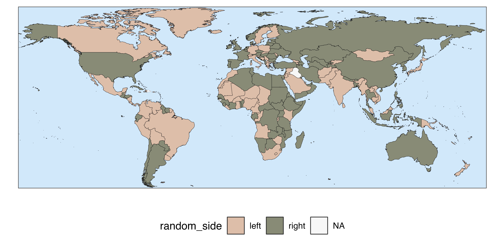
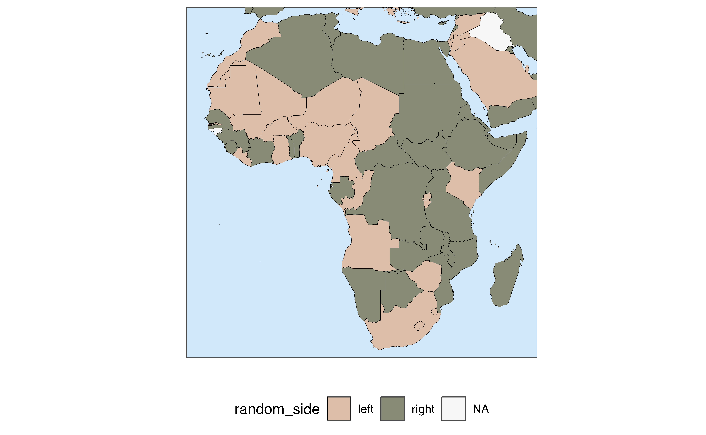
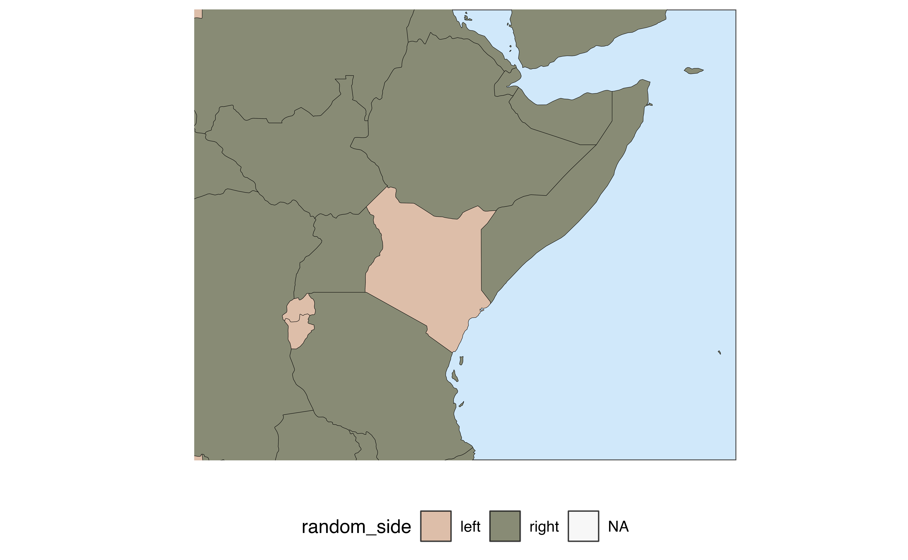
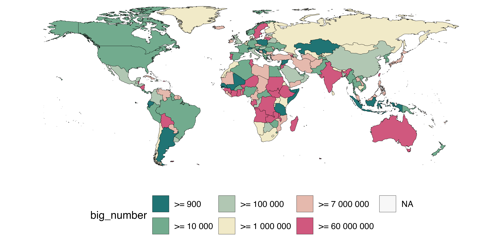
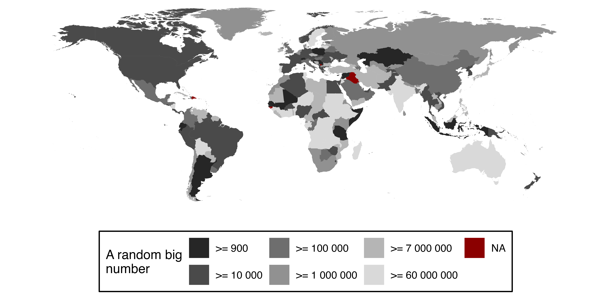
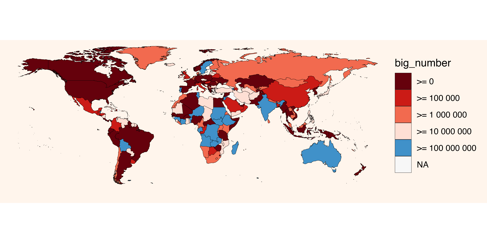
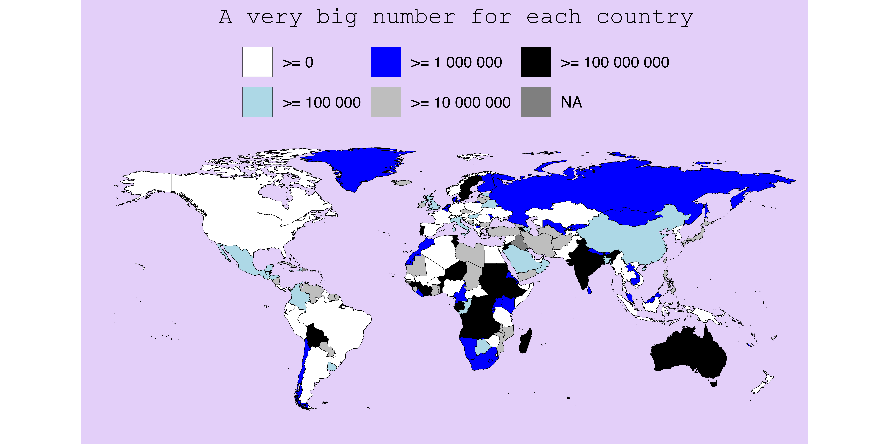

# Easy country chloropleth maps

[Chloropleth maps](https://en.wikipedia.org/wiki/Choropleth_map) can be
a powerful visual tool to communicate information about countries.
However, making a nice map in R can be deceivingly time-consuming. This
is where
[`quick_map()`](https://fbellelli.github.io/countries/reference/quick_map.md)
can help!

Its fuzzy matching algorithm automatically recognises country names and
cuts the hassle of matching country data to country shapes. Predefined
colour themes and zooms are provided, to cut the time involved in making
a nice looking map. It even provides an easy integrated option to save
the plot locally with predefined settings.

With
[`quick_map()`](https://fbellelli.github.io/countries/reference/quick_map.md)
you can produce a publication-grade plot with one short line of code. If
you are still not happy with how your map looks, customisation is
endless with all the usual ggplot commands.

In this vignette, we will walk through some examples.

## Some data to plot

Let’s start by loading the package and putting together a table with
mock country data which we will use for demonstration. This table
contains the following mock variables: big_number (a numeric continuous
variable), a boolean variable, and a character (string) variable.

``` r

library(countries)

# Mock data
data <- data.frame(country = random_countries(245),
                   big_number = runif(245, 0, 1) * 10^runif(245, 4, 9),
                   boolean = sample(c(TRUE, FALSE), 245, replace = TRUE),
                   random_side = sample(c("left", "right"), 245, replace = TRUE))
```

## Quick start

All it takes to make a plot is one line of code telling to plot the
column `"random_side"` from the table `data`. The function will take
care of everything else. Under the hood, the function looks for a column
of country names and matches them to one of the territories in the [ISO
standard 3166-1](https://en.wikipedia.org/wiki/ISO_3166-1).

``` r

quick_map(data, plot_col = "random_side", verbose = FALSE)
```



### Saving your plot

The plot can be saved by passing a file path to the argument `save_to`.
This comes with predefined size and resolution options. If you wish a
more customised download, the function
[`ggplot2::ggsave()`](https://ggplot2.tidyverse.org/reference/ggsave.html)
can be used.

``` r

quick_map(data, plot_col = "random_side", 
          save_to = "example_path/plot.png")
```

### What happens if a country is not recognised ?

When a country name is not recognised or does not match with a country
in the standard, a warning is given to the user. In the example below,
the country that has no match (UNK) is Kosovo, which is not in the ISO
3166-1 standard.

If you are interested in knowing exactly how the country were matched
you can just use the function
[`country_name()`](https://fbellelli.github.io/countries/reference/country_name.md).

``` r


p <- quick_map(data.frame(country = c("FRA", "UNK", "Greece"), 
                     random_side = c("left", "right", "left")), 
          plot_col = "random_side")
#> Some country IDs have no match in one or more of the requested country naming conventions, NA returned.
#> 
#> Set - verbose - to TRUE for more details
```

## Zooming / Regional maps

Suppose you wish to plot a map of specific regions of the globe. The
package comes with predefined zoom settings
`c("Default", "World", "Africa", "Asia", "Europe", "SEAsia", "NAmerica", "CAmerica", "SAmerica", "Oceania")`.
Alternatively, it is also possible to define a custom zoom by passing
the min/max longitude and latitude.

``` r

quick_map(data, plot_col = "random_side", zoom = "Africa")
```



``` r

quick_map(data, plot_col = "random_side", zoom = c(25, 55, -10, 15))
```



## Customising the look of your map

The function provides basic settings to customise the essential elements
of the map in a simple way. If these changes are not enough, full
customisation can be achieved with ggplot commands. Let’s see some
examples.

### Themes and visual settings

With the argument `theme` it is possible to switch among the predefined
looks for the map. `theme` can take as a value a number between 1 and
11, or one of the predefined themes’ names:
`c("Default", "Greyscale", "Candy", "RedBlue", "Dark", "Reds", "Blues", "Greens", "Viridis", "Cividis", "Distinct")`.
If `0` or `"NoTheme"` is passed, ggplot2 settings are used (no theme is
applied to the map).

``` r

quick_map(data, plot_col = "big_number", verbose = FALSE,
          theme = "Candy")
```



Some basic visual elements can be modified within
[`quick_map()`](https://fbellelli.github.io/countries/reference/quick_map.md).
For instance, In case you are not happy with the colour ordering, it can
be reversed with `reverse_palette = TRUE`. `col_na` can be used to set
the colour for countries with missing data (NAs), the variable name can
be changed with `name_legend`, finally, `col_na` and `width_border` set
the colour and thickness of the border lines between territories (or
remove them altogether).

``` r

quick_map(data, plot_col = "big_number", verbose = FALSE,
          theme = "Greyscale",
          reverse_palette = TRUE,
          name_legend = "A random big\nnumber", 
          col_na = "darkred",
          col_border = "NA") # here we are removing the border lines
```



### Colour scale breaks

By default,
[`quick_map()`](https://fbellelli.github.io/countries/reference/quick_map.md)
discretises continuous variables, such as population, in 6 buckets for
plotting. This is because continuous scales usually are not easy to
visually interpret in world maps. This means that the colour assignment
depends on the bucket in which the country falls. In some cases, the
automatic buckets defined by
[`quick_map()`](https://fbellelli.github.io/countries/reference/quick_map.md)
may not yield the best results. Users can supply values for the colour
breaks manually with the argument `col_breaks`. In the example below, I
manually pass powers of ten as breaks.

``` r

quick_map(data, plot_col = "big_number", verbose = FALSE,
          theme = "RedBlue",
          col_breaks = c(0, 1e5, 1e6, 1e7 , 1e8, 1e9))
```



Some predefined themes have only a limited number of colours. If you
have many breaks, the following themes support more colours:
`c("Greyscale", "Dark", "Reds", "Blues", "Greens", "Viridis", "Cividis", "Distinct")`.
Finally, if you wish to keep a continuous colour scale, instead of a
disretised one, you can request the raw ggplot output with `theme = 0`.

### Advanced customisation

The nice thing about
[`quick_map()`](https://fbellelli.github.io/countries/reference/quick_map.md)
is that the output is a ggplot object, so customisation is truly
endless. Let’s start with our last plot:

``` r

p <- quick_map(data, plot_col = "big_number", verbose = FALSE,
          theme = "RedBlue",
          col_breaks = c(0, 1e5, 1e6, 1e7 , 1e8, 1e9))
```

The look of the can be customised with any of ggplot’s `theme` or
`scale` commands. For example, below I remove the name of the legend,
**provide custom colours** for the 6 buckets, add a title and change the
background:

``` r

library(ggplot2)

# let's define 6 colours for our map
colours6 <- c("white", "lightblue", "blue", "grey", "black","yellow")

# let's apply them to our plot!
p +
  scale_fill_manual(name = NULL,  # remove name in fill legend
                    values = colours6)+ # use custom colours
  ggtitle("A very big number for each country") + # add a title to the plot 
  theme(plot.background = element_rect(fill = "#e3cff9"), # change colour of background
        legend.position = "top",  # move legend on top
        plot.title = element_text(hjust = 0.5, family = "mono")) # center the title and change font family
```



Anything that works with ggplot will work also with the output of
[`quick_map()`](https://fbellelli.github.io/countries/reference/quick_map.md).
It’s even possible to **add annotations or additional layers** to the
map. For example, in the image below, I am adding text, arrows and
markers corresponding by passing their longitude and latitude as
coordinates.

``` r

# create the coordinates for random points
data$long <- runif(n = nrow(data), -150, 150)
data$lat <- runif(n = nrow(data), -80, 80)
data$name <- paste("Point", 1:nrow(data))

# make a map
quick_map(data, "boolean", zoom = "Europe", theme = "Greens")+
  geom_point(data = data, mapping = aes(x = long, y = lat, group = NULL), shape = 10) + # add markers for the random points
  geom_text(data = data[1:50,], mapping = aes(x = long, y = lat, label = name, group = NULL), size = 3, nudge_y = -1) + # printing name next to some of the random points
  annotate("segment", x = 18, y = 35, xend = 14, yend = 42,
           arrow = arrow(type = "closed", length = unit(0.02, "npc")))+   # add an arrow
  annotate("label", x = 18, y = 35, label = "A boot!")  # add a text annotation
```


